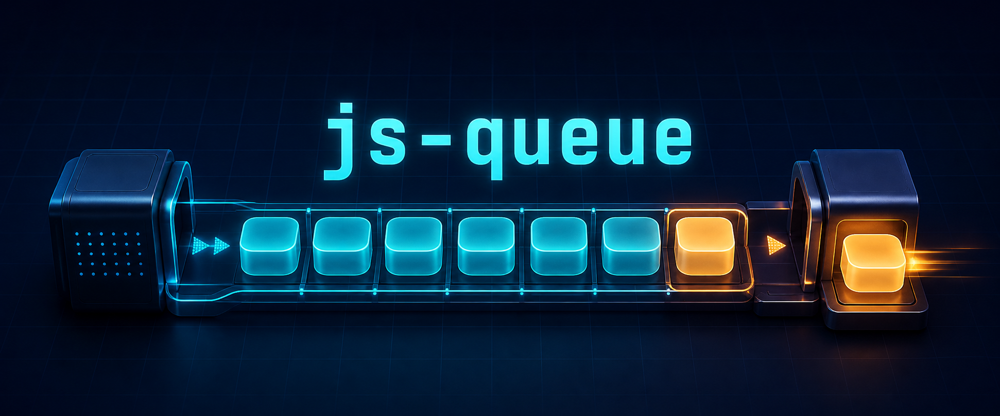

# js-queue

A tiny first-in-first-out task queue with explicit flow control. Add functions, let the queue start automatically, and call `this.next()` when each task is ready to release the next one.

[Documentation](https://riaevangelist.github.io/js-queue/) · [Quick start](https://riaevangelist.github.io/js-queue/guide/) · [API](https://riaevangelist.github.io/js-queue/api/) · [Patterns](https://riaevangelist.github.io/js-queue/patterns/) · [Browser use](https://riaevangelist.github.io/js-queue/browser/) · [Examples](https://riaevangelist.github.io/js-queue/examples/) · [Testing](https://riaevangelist.github.io/js-queue/testing/)

[](https://github.com/RIAEvangelist/js-queue/actions/workflows/ci.yml)
[](https://github.com/RIAEvangelist/js-queue/actions/workflows/pages.yml)
[](https://www.npmjs.com/package/js-queue)
[](https://www.npmjs.com/package/js-queue)
[](./licence.md)

## Install

```sh
npm install js-queue
```

Native ES modules:

```js
import Queue from 'js-queue';

const queue=new Queue;

queue.add(
    function(){
        console.log('first');
        this.next();
    },
    function(){
        console.log('second');
        this.next();
    }
);
```

CommonJS remains supported:

```js
const Queue=require('js-queue');
```

## The flow contract

`js-queue` does not guess when a task is complete. A task releases the next item by calling `this.next()`—immediately, from a callback, or after an awaited operation.

```js
queue.add(function(){
    fetch('/work')
        .then(handleResponse)
        .finally(()=>this.next());
});
```

That explicit hand-off makes the same queue useful for synchronous steps, callback APIs, network work, connection gates, and manually controlled pipelines.

## Public surface

| Member | Type | Purpose |
| --- | --- | --- |
| `add(...tasks)` | method | Validate and append functions; auto-start when idle. |
| `next()` | method | Run the next FIFO task when the queue is not stopped. |
| `clear()` | method | Remove pending tasks and return the new empty array. |
| `contents` | getter/setter | Read or replace the pending function array. |
| `size` | getter | Number of pending tasks. |
| `running` | getter | Whether a task currently owns the queue. |
| `autoRun` | boolean | Start automatically after `add()`; defaults to `true`. |
| `stop` | boolean | Hold execution without discarding pending work. |

Every task receives the queue as `this`. Invalid tasks are rejected before any item from the same `add()` call is appended. If a task throws synchronously, the queue returns to an idle, recoverable state and preserves the remaining work.

## Entry points

| Import | Format | Use |
| --- | --- | --- |
| `js-queue` | ESM or CommonJS | Conditional primary entry. |
| `js-queue/queue.js` | ESM or CommonJS | Compatibility path to the queue. |
| `js-queue/queue-vanilla.js` | classic browser script | Publishes `globalThis.Queue`. |
| `js-queue/stack` | ESM or CommonJS | The modernized `easy-stack` 2.0 LIFO entry. |

The runtime supports Node.js 12.22 and newer. The development suite uses `vanilla-test` 2.1.1 on Node.js 22.12 or newer, while a test-tooling-free compatibility runner executes all behavior and package contracts on older supported Node releases with production dependencies only.

## Test and coverage evidence

**Tested with [vanilla-test](https://riaevangelist.github.io/vanilla-test/).** The shared behavioral suite runs unchanged in Node and real Google Chrome. It covers FIFO ordering, manual flow, stop/resume gates, active-task additions, clearing, replacement contents, validation, thrown-task recovery, asynchronous hand-offs, and idle behavior.

<a href="https://riaevangelist.github.io/vanilla-test/"></a>

```sh
npm test
npm run coverage
```

Both native V8 collectors enforce 100% statement, branch, function, and line coverage for the shipped ESM queue. Package tests independently verify ESM, CommonJS, classic-browser, and stack entry points. Server tests verify pages, content types, missing files, malformed URLs, and traversal protection. Documentation tests verify every page, local target, workflow, and generated header asset.

[Node coverage report](https://riaevangelist.github.io/js-queue/reports/node/) · [Chrome coverage report](https://riaevangelist.github.io/js-queue/reports/chrome/)

## Version 3

Version 3 adds native ESM, conditional CommonJS compatibility, validated task inputs, observable `size` and `running` state, recoverable synchronous errors, modern package boundaries, and the new documentation site. Existing `require('js-queue')`, `require('js-queue/stack.js')`, and classic `<script>` consumers have supported paths.

Read the [migration guide](./MIGRATION.md) and [changelog](./CHANGELOG.md) before upgrading an application that depends on constructor enumeration, non-function queue entries, or Node versions older than 12.22.

## License

[MIT](./licence.md)
