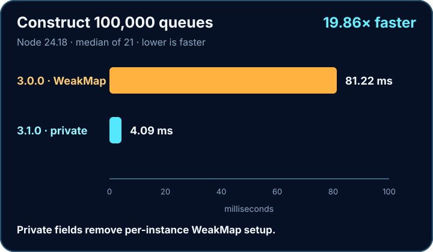
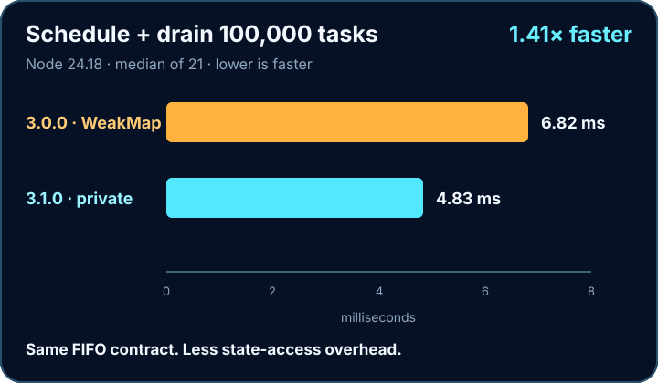

# js-queue

A tiny first-in-first-out task queue with explicit flow control. Add functions, let the queue start automatically, and call `this.next()` when each task is ready to release the next one.

[Documentation](https://riaevangelist.github.io/js-queue/) · [Quick start](https://riaevangelist.github.io/js-queue/guide/) · [API](https://riaevangelist.github.io/js-queue/api/) · [Patterns](https://riaevangelist.github.io/js-queue/patterns/) · [Browser use](https://riaevangelist.github.io/js-queue/browser/) · [Examples](https://riaevangelist.github.io/js-queue/examples/) · [Playground](https://riaevangelist.github.io/js-queue/playground/) · [Performance](https://riaevangelist.github.io/js-queue/performance/) · [Testing](https://riaevangelist.github.io/js-queue/testing/)

[](https://github.com/RIAEvangelist/js-queue/actions/workflows/ci.yml)
[](https://github.com/RIAEvangelist/js-queue/actions/workflows/pages.yml)
[](https://www.npmjs.com/package/js-queue)
[](https://www.npmjs.com/package/js-queue)
[](./licence.md)

## Install

```sh
npm install js-queue
```

Native ES modules:

```js
import Queue from 'js-queue';

const queue=new Queue;

queue.add(
    function(){
        console.log('first');
        this.next();
    },
    function(){
        console.log('second');
        this.next();
    }
);
```

CommonJS remains supported:

```js
const Queue=require('js-queue');
```

## Browser ESM: bundler or no bundler

`js-queue` works with bundlers and without a bundler. Bundlers resolve the bare package imports normally. Native browser ESM uses a standard import map and runs the same JavaScript directly, with no build or transpilation step.

For a normal npm layout where `easy-stack` is hoisted, place this complete import map before the module script:

```html
<script type="importmap">
{
  "imports": {
    "js-queue": "./node_modules/js-queue/queue.js",
    "js-queue/": "./node_modules/js-queue/",
    "js-queue/stack": "./node_modules/js-queue/stack.js",
    "js-queue/stack.js": "./node_modules/js-queue/stack.js",
    "easy-stack": "./node_modules/easy-stack/stack.js"
  }
}
</script>
<script type="module">
  import Queue from 'js-queue';
  import Stack from 'js-queue/stack';

  const queue=new Queue;
  const stack=new Stack;
</script>
```

If npm nests `easy-stack` because the application installs a conflicting root version, use this complete scoped map instead. Its scope preserves the dependency boundary that Node and bundlers apply to imports originating inside `js-queue`:

```html
<script type="importmap">
{
  "imports": {
    "js-queue": "./node_modules/js-queue/queue.js",
    "js-queue/": "./node_modules/js-queue/",
    "js-queue/stack": "./node_modules/js-queue/stack.js",
    "js-queue/stack.js": "./node_modules/js-queue/stack.js",
    "easy-stack": "./node_modules/easy-stack/stack.js"
  },
  "scopes": {
    "./node_modules/js-queue/": {
      "easy-stack": "./node_modules/js-queue/node_modules/easy-stack/stack.js"
    }
  }
}
</script>
<script type="module">
  import Stack from 'js-queue/stack';

  const stack=new Stack;
</script>
```

Every import-map URL is relative to the HTML document. Serve the application over HTTP(S), and configure that server to expose the mapped `node_modules` files. `file://` is not a supported loading path. See the [browser guide](https://riaevangelist.github.io/js-queue/browser/) for the classic-script option and live no-bundler examples.

## The flow contract

`js-queue` does not guess when a task is complete. A task releases the next item by calling `this.next()`—immediately, from a callback, or after an awaited operation.

```js
queue.add(function(){
    fetch('/work')
        .then(handleResponse)
        .finally(()=>this.next());
});
```

That explicit hand-off makes the same queue useful for synchronous steps, callback APIs, network work, connection gates, and manually controlled pipelines.

## Performance

**The fastest js-queue yet. Install it. Don’t rebuild it.**





Node 24.18, 100,000 operations, median of 21 alternating samples. [Method and results](https://riaevangelist.github.io/js-queue/performance/). CI reruns the tagged comparison.

## Public surface

| Member | Type | Purpose |
| --- | --- | --- |
| `add(...tasks)` | method | Validate and append functions; auto-start when idle. |
| `next()` | method | Run the next FIFO task when the queue is not stopped. |
| `clear()` | method | Remove pending tasks and return the new empty array. |
| `contents` | getter/setter | Read or replace the pending function array. |
| `size` | getter | Number of pending tasks. |
| `running` | getter | Whether a task currently owns the queue. |
| `autoRun` | boolean | Start automatically after `add()`; defaults to `true`. |
| `stop` | boolean | Hold execution without discarding pending work. |

Every task receives the queue as `this`. Invalid tasks are rejected before any item from the same `add()` call is appended. If a task throws synchronously, the queue returns to an idle, recoverable state and preserves the remaining work.

## Entry points

| Import | Format | Use |
| --- | --- | --- |
| `js-queue` | ESM or CommonJS | Conditional primary entry. |
| `js-queue/queue.js` | ESM or CommonJS | Compatibility path to the queue. |
| `js-queue/queue-vanilla.js` | classic browser script | Publishes `globalThis.Queue`. |
| `js-queue/stack` | ESM or CommonJS | The modernized `easy-stack` 2.1 LIFO entry. |

The runtime supports Node.js 22.13 and newer. Native ESM and CommonJS both load the same synchronous source files; no duplicate Node build is shipped.

## Test and coverage evidence

**Tested with [vanilla-test](https://riaevangelist.github.io/vanilla-test/).** The repository has 102 focused checks organized into five non-overlapping layers: [Unit](https://riaevangelist.github.io/js-queue/testing/unit/), [Functional](https://riaevangelist.github.io/js-queue/testing/functional/), [Behavioral](https://riaevangelist.github.io/js-queue/testing/behavioral/), [Integration](https://riaevangelist.github.io/js-queue/testing/integration/), and [Regression](https://riaevangelist.github.io/js-queue/testing/regression/). Forty-two shared checks import the package by its bare name and run unchanged in Node and real Google Chrome; Chrome resolves those imports through the checked-in import-map configuration.

<a href="https://riaevangelist.github.io/vanilla-test/"></a>

```sh
npm test
npm run test:unit
npm run test:functional
npm run test:behavioral
npm run test:integration
npm run test:regression
npm run test:consumer
npm run coverage
```

The 10 Unit checks isolate API facts. The 30 Functional checks cover queue workflows and Playground behavior. The 9 Behavioral checks verify complete consumer outcomes across explicit hand-offs, gates, recovery policies, stale-reference isolation, independent queues, reprioritization, and native no-bundler loading. The 28 Integration checks cover interacting queue operations, package formats, a poisoned packed-consumer dependency conflict, benchmark evidence, stack compatibility, and local HTTP delivery. The 25 Regression checks protect validation, recovery, the no-WeakMap performance contract, import maps, documentation, artwork, and deployment wiring. Both native V8 collectors continue to enforce 100% statement, branch, function, and line coverage for the shipped ESM queue.

[Node coverage report](https://riaevangelist.github.io/js-queue/reports/node/) · [Chrome coverage report](https://riaevangelist.github.io/js-queue/reports/chrome/)

## Version 3.1

Version 3.1 replaces WeakMap lookups with private instance fields, shares one Node source between `import` and `require`, and moves the runtime floor to Node 22.13. Existing `require('js-queue')` and `require('js-queue/stack.js')` syntax remains supported on that Node floor; `queue-vanilla.js` remains available to current browsers with native private fields.

Read the [migration guide](./MIGRATION.md) and [changelog](./CHANGELOG.md) before upgrading an application on Node versions older than 22.13.

## License

[MIT](./licence.md)
